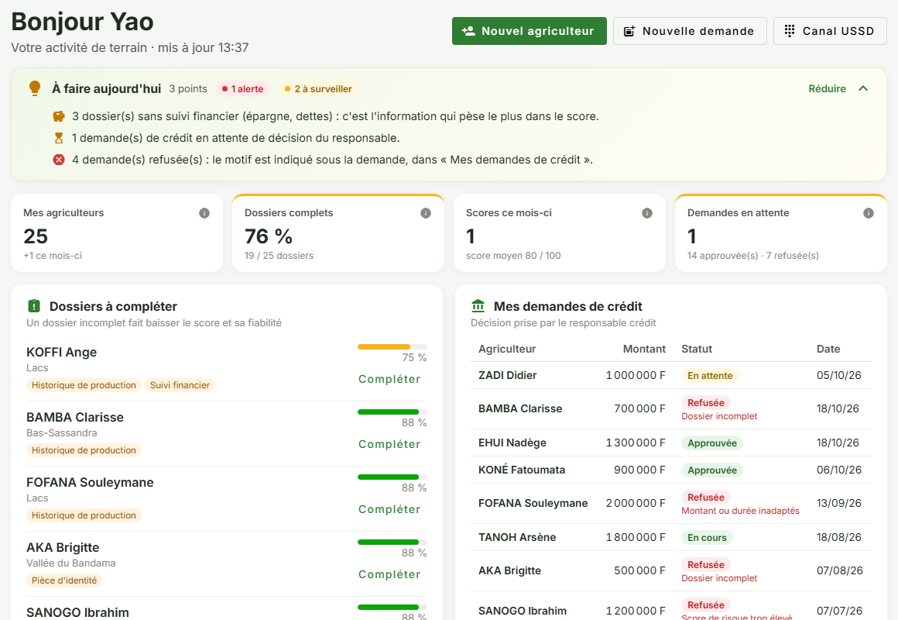
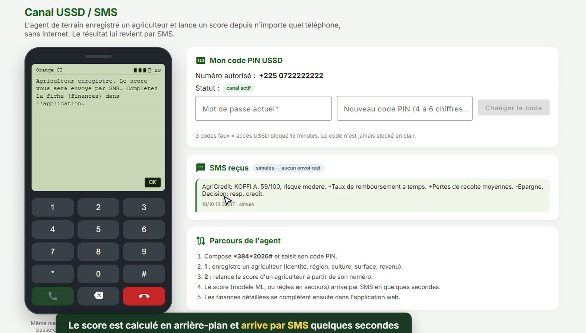
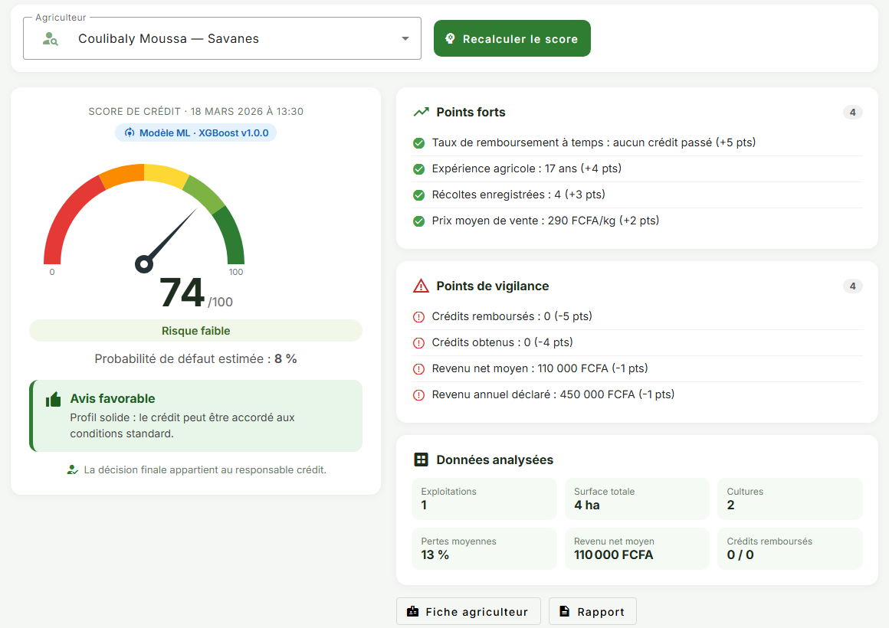
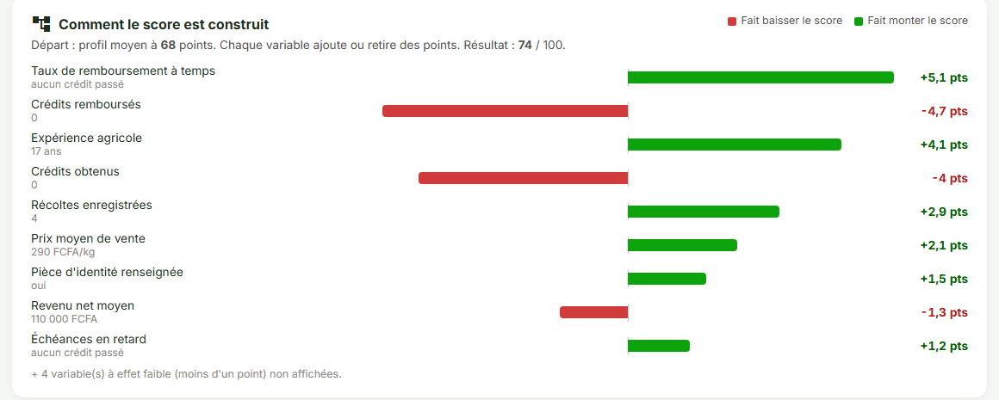
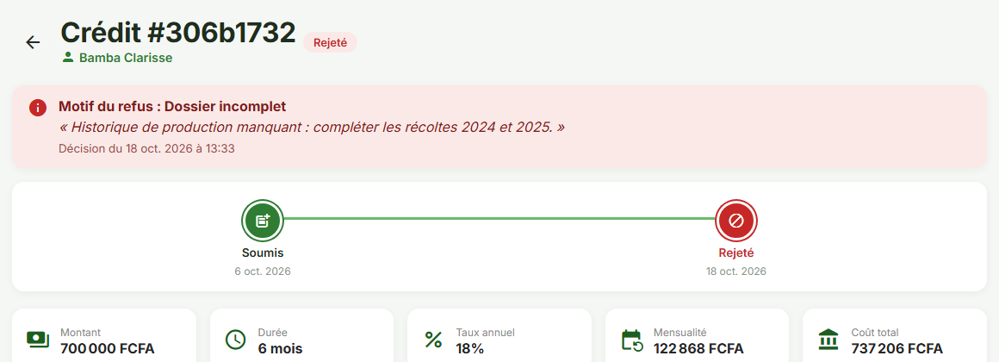
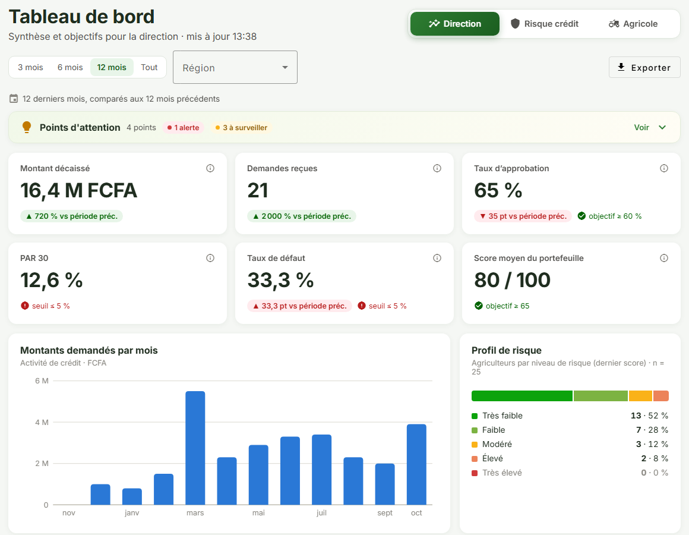
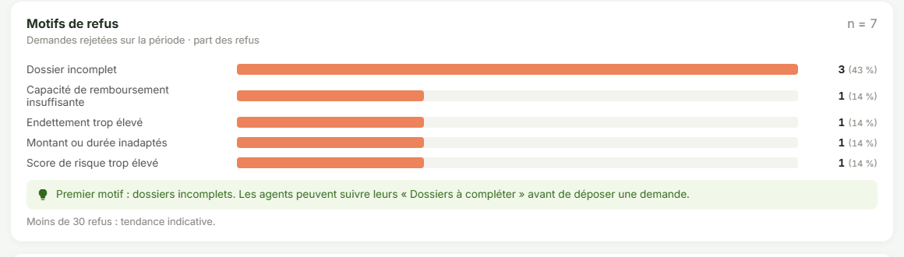

# 🌾 AgriCredit AI

**Le logiciel de crédit agricole clé en main pour les institutions de microfinance et les coopératives, utilisable même sans internet sur le terrain.**


> Ce dépôt est une **vitrine** : il présente le projet, ses écrans et son fonctionnement.
> Le code source est privé. Une démonstration est possible sur demande.

---

## Le problème

En Côte d'Ivoire, seulement **5 % environ des petits producteurs ont accès au crédit** (GIZ), et à peine **9,5 % du crédit des institutions de microfinance va à l'agriculture** (Banque mondiale).

Un agriculteur a rarement un historique bancaire, ses revenus sont saisonniers et dépendent de la météo, et il vit souvent dans une zone mal couverte par internet. Pour une institution financière, chaque dossier agricole est donc long à monter et difficile à évaluer.

## La solution

AgriCredit AI accompagne tout le parcours d'un crédit agricole :

| Étape | Ce que fait l'outil |
|---|---|
| **Collecte** | L'agent de terrain monte un dossier complet : identité, exploitations, cultures, récoltes et pertes, revenus, épargne, dettes. Les informations manquantes sont signalées. |
| **Sans internet** | Depuis n'importe quel téléphone, l'agent inscrit un agriculteur par **USSD** et reçoit le score **par SMS**. |
| **Évaluation** | Un score de risque de 0 à 100, une probabilité de défaut, et **l'explication de chaque point** : ce qui fait monter ou baisser le score. |
| **Décision** | Le responsable crédit approuve (l'échéancier est généré) ou refuse avec un **motif obligatoire**, transmis à l'agent et tracé. |
| **Suivi** | Remboursements, retards (PAR 30), défauts, motifs de refus, risque par région : un tableau de bord par profil. |

**Principe : l'IA éclaire, l'humain décide.**

---

## Aperçu

### Pour l'agent de terrain
Son travail du jour : dossiers à compléter, demandes en cours, derniers scores.



### Sans internet : USSD et SMS
Le même menu que sur un vrai téléphone. Le score arrive par SMS quelques secondes après l'inscription.



### Un score qui s'explique
Score, probabilité de défaut, points forts et points de vigilance…



…et la contribution de chaque élément du dossier, en points.



### Pour le responsable crédit
Chaque refus est motivé, daté et transmis à l'agent.



### Pour la direction
Le portefeuille en un coup d'œil, et les causes de refus avec l'action recommandée.





*Toutes les captures utilisent des données fictives de démonstration.*

---

## Vidéo de démonstration (3 minutes)

<!-- Pour intégrer la vidéo : éditer ce fichier sur github.com, glisser-déposer le fichier .mp4 ici, puis enregistrer. -->
_Vidéo à venir sur cette page._

---

## Comment ça marche

```
 Agent de terrain ──► Application web (Angular) ──┐
                                                    ├──► API (Spring Boot) ──► PostgreSQL
 Téléphone simple ──► USSD (opérateur) ────────────┘          │
        ▲                                                      ▼
        └──────────── SMS du score ◄────────────── Service de scoring IA (Python)
                                                     modèle + explication de chaque point
```

- **Score par apprentissage automatique**, avec l'explication de chaque variable. Un moteur de règles prend le relais si le modèle est indisponible.
- **Recalibrable** : le modèle s'ajuste à la clientèle d'une institution à partir de ses dossiers historiques.
- **Sécurité** : comptes et droits par rôle (agent, responsable crédit, administrateur), journal des décisions, code PIN pour l'USSD, communications chiffrées.

### Technologies


Angular · Spring Boot (Java 21) · PostgreSQL · FastAPI · XGBoost et SHAP (score explicable) · USSD/SMS (format Africa's Talking) · Docker

---

## Où en est le projet

| | |
|---|---|
| ✅ **Prêt** | Application complète et canal USSD/SMS en mode démonstration |
| 🔬 **À valider** | Le modèle a été entraîné sur des données simulées construites à partir de statistiques publiques. Il doit être recalibré et mesuré sur les dossiers réels d'une institution partenaire avant tout usage en production. |
| 🚀 **À venir** | Démo en ligne, raccordement à un opérateur pour l'USSD et les SMS réels |

## Vous êtes une institution de microfinance ou une coopérative ?

Je recherche une **institution partenaire pour un projet pilote** : démonstration, calibrage du score sur vos dossiers anonymisés, puis test sur le terrain dans une agence.

## Contact

**N'Dri Jaurès**, fondateur et développeur
📧 jjaures077@gmail.com · 💼[LinkedIn](https://www.linkedin.com/in/konan-jean-jaures-n-dri-380255273/) <!-- remplacer # par l'adresse de ton profil -->

---

<sub>© 2026 N'Dri Konan Jean Jaurès. Tous droits réservés. Le code source d'AgriCredit AI est privé ; ce dépôt ne contient que des éléments de présentation.</sub>
